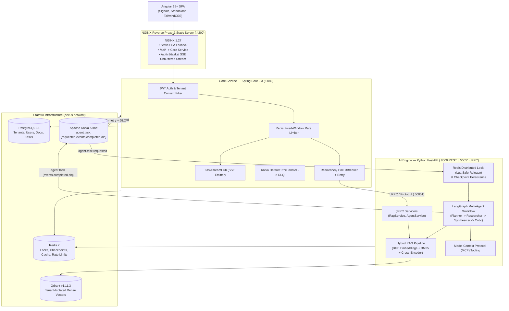

# NexusEnterprise Hub

**Production Multi-Tenant Enterprise AI Platform** combining **Angular 18+** (Signals + TailwindCSS), **Spring Boot 3.3** (JWT Multi-Tenancy + Resilience4j + SSE), and **Python FastAPI / LangGraph** (Hybrid RAG + Cross-Encoder Reranking + MCP + Distributed Redis Coordination) over **gRPC/Protobuf** and **Apache Kafka (KRaft)**.

---

## System Architecture



---

## Tech Stack Matrix

| Layer | Technologies & Patterns |
| :--- | :--- |
| **Frontend Gateway** | Angular 18+ (Standalone Components, Signals, `inject()`, Functional Guards/Interceptors), TailwindCSS, Lucide Icons, NGINX 1.27 (SSE-unbuffered proxy) |
| **Core Backend** | Java 21, Spring Boot 3.3, Spring Security (Stateless JWT + `?token=` SSE auth), Flyway Migrations, Spring Data JPA, Resilience4j (`CircuitBreaker` + `Retry`), Spring Kafka |
| **AI & ML Engine** | Python 3.11, FastAPI, LangGraph, LangChain, Model Context Protocol (`mcp`), `sentence-transformers` (`BAAI/bge-small-en-v1.5`, `cross-encoder/ms-marco-MiniLM-L-6-v2`), `rank-bm25`, `aiokafka` |
| **Inter-Service RPC** | Protocol Buffers (`proto/ai/v1/*.proto`) & bidirectional/server-streaming gRPC (`50051`) |
| **Messaging & Fault Tolerance** | Apache Kafka 7.6.1 (KRaft, 3 partitions/topic), Explicit offset commits, Exponential backoff + `agent.task.dlq` routing, Distributed Redis Task Locks |
| **Storage & Caching** | PostgreSQL 16, Qdrant v1.11.3, Redis 7 (`Rate Limiter`, `Distributed Locks`, `LangGraph Checkpoints`, `Hybrid Search Cache`) |
| **CI/CD & Packaging** | Multi-stage Docker builds, Docker Compose (8-container stack), Makefile automation, Path-filtered GitHub Actions |

---

## Quickstart Guide

### Prerequisites
- Docker Engine & Docker Compose v2+
- Minimum 6 GB RAM allocated to Docker (for JVM, Kafka KRaft, Qdrant, and HuggingFace neural models)

### 1. One-Command Production Launch

```bash
# 1. Create .env and replace EVERY "change-me" value (compose refuses to start with missing secrets):
#    POSTGRES_PASSWORD, REDIS_PASSWORD, QDRANT_API_KEY, JWT_SECRET (>= 32 chars), INTERNAL_API_KEY (>= 16 chars)
#    Optional: LLM_API_KEY / LLM_BASE_URL / LLM_MODEL for any OpenAI-compatible LLM (empty = deterministic mode)
cp .env.example .env

# 2. Local development (backend/infra ports bound to 127.0.0.1 via docker-compose.override.yml)
docker compose --env-file .env -f deploy/docker-compose.yml -f deploy/docker-compose.override.yml up -d --build

# Production-shaped run: only the NGINX gateway (4200) is published
docker compose --env-file .env -f deploy/docker-compose.yml up -d --build
```

Or using `make` (uses the development override):
```bash
make up
```

### 2. Service & Ports Map

Only the frontend gateway is published by `deploy/docker-compose.yml`. The other host ports below exist
only with `deploy/docker-compose.override.yml` and are bound to `127.0.0.1`.

| Service | Container Name | Host Port(s) | Purpose / Health Endpoint |
| :--- | :--- | :--- | :--- |
| **Frontend + NGINX** | `nexus-frontend` | `4200` | Angular UI & API/SSE Gateway (`http://localhost:4200/nginx-health`) |
| **Core Service** | `nexus-core-service` | `127.0.0.1:8080` (dev) | REST API, JWT Auth, SSE Hub (`/actuator/health` public; other actuator endpoints require ADMIN) |
| **AI Service** | `nexus-ai-service` | `127.0.0.1:8000`, `127.0.0.1:50051` (dev) | Internal only: every call except `/healthz` & `/readyz` requires `X-Internal-Api-Key` (HTTP) / `x-internal-api-key` (gRPC metadata) |
| **PostgreSQL 16** | `nexus-postgres` | `127.0.0.1:5432` (dev) | Relational persistence (`nexus_db`, schema `core`) |
| **Redis 7** | `nexus-redis` | `127.0.0.1:6379` (dev) | Token revocation, distributed locking, rate limiting (`noeviction`) |
| **Qdrant** | `nexus-qdrant` | `127.0.0.1:6333`, `127.0.0.1:6334` (dev) | Vector DB (requires `api-key` header = `QDRANT_API_KEY`) |
| **Apache Kafka** | `nexus-kafka` | `127.0.0.1:9092` (dev) | KRaft event broker (`agent.task.requested`, `.events`, `.completed`, `.dlq`) |
| **Kafka Init** | `nexus-kafka-init` | — | Idempotent startup topic provisioner |

### 3. Authentication & Demo Workspace Access

1. Open **`http://localhost:4200`** in your browser.
2. On first launch (clean database), click **Create Organization / Register** or register via API to provision your tenant and user account (e.g. demo credentials `bob@techcorp.io` / `ProductionPassword2026!`, Organization `TechCorp`), or sign in if your PostgreSQL volume already contains your seeded tenant:

```bash
curl -X POST http://localhost:4200/api/v1/auth/register \
  -H "Content-Type: application/json" \
  -d '{
    "organizationName": "TechCorp",
    "fullName": "Bob Architect",
    "email": "bob@techcorp.io",
    "password": "ProductionPassword2026!"
  }'
```

---

## End-to-End Platform Workflow

### Step 1 — Multi-Tenant Document Ingestion (`Knowledge Base`)
1. Navigate to **Knowledge Base** in the Angular UI (or `POST /api/v1/documents/upload`).
2. `core-service` validates the tenant quota (`TenantRateLimitFilter` in Redis), persists file bytes to the shared Docker volume (`/shared-uploads`), saves metadata in PostgreSQL, and invokes `RagGrpcClient.ingestDocument(...)` protected by Resilience4j (`aiServiceGrpc` circuit breaker + `aiServiceRetry`).
3. `ai-service` chunks the PDF/text, generates 384-d `BAAI/bge-small-en-v1.5` embeddings, and upserts vectors into Qdrant tagged with `tenant_id` for strict cross-tenant isolation.

### Step 2 — Hybrid Vector + Lexical Search & Cross-Encoder Reranking
1. Query the Knowledge Base (`POST /api/v1/documents/search`) with `topK`, `alpha` (dense/sparse blend), and `rerank: true`.
2. `ai-service` checks Redis cache (`rag:search:{tenant}:{hash}`), retrieves top-N semantic vectors from Qdrant filtered by `tenant_id`, combines them with BM25 lexical scoring, and re-scores candidates with `cross-encoder/ms-marco-MiniLM-L-6-v2`.

### Step 3 — Multi-Agent LangGraph Orchestration & Real-Time SSE Streaming (`Agent Studio`)
1. Submit a task (`DEEP_RESEARCH` or `DOCUMENT_ANALYSIS`) via **Agent Studio** (`POST /api/v1/tasks`).
2. `core-service` stores the task as `PENDING` and publishes `AgentTaskRequestedEvent` to Kafka topic `agent.task.requested`.
3. The Angular UI opens an `EventSource` stream to `/api/v1/tasks/{taskId}/stream?token={jwt}`, proxied unbuffered through NGINX.
4. `ai-service` consumes the Kafka record, acquires a Lua-guarded Redis distributed lock (`lock:task:{taskId}`) to prevent duplicate execution, persists state checkpoints in Redis, and runs the 4-node LangGraph pipeline (`PLANNER` -> `RESEARCHER` -> `SYNTHESIZER` -> `CRITIC`) equipped with MCP tools.
5. Node telemetry streams live via `agent.task.events` -> `core-service` `TaskStreamHub` -> NGINX SSE -> Angular Signals dashboard, concluding with `agent.task.completed` (or automatic `agent.task.dlq` routing on poison-pill errors).

---

## AI Quality Assurance, Evaluation & Red-Teaming (RAGAS, DeepEval, Giskard)

NexusEnterprise Hub embeds an automated AI quality-gate and adversarial red-teaming suite under `services/ai-service/tests/evals/`, backed by a curated 5-case multi-tenant benchmark (`golden_dataset.json`) and an isolated in-memory Qdrant vector harness (`QdrantClient(":memory:")`).

### Dual-Mode Execution (Online LLM Judge + Offline CPU CI)
- **Offline / CI Mode (default when `OPENAI_API_KEY` is unset)**: Runs 100% locally on CPU with zero API cost and zero external infrastructure dependencies by combining deterministic grounding checks with our local HuggingFace neural stack (`BAAI/bge-small-en-v1.5` embeddings + `cross-encoder/ms-marco-MiniLM-L-6-v2` reranker).
- **Online LLM-as-a-Judge Mode (`OPENAI_API_KEY` set)**: Automatically upgrades RAGAS and DeepEval suites to invoke an external LLM judge (configurable via `EVAL_JUDGE_MODEL`, default `gpt-4o-mini`) and supports full `giskard.scan()` when `RUN_GISKARD_LLM_SCAN=1`.

### Metrics, Probes & Enforced Quality Thresholds

| Framework | Test Suite | Metrics / Security Probes | Quality Gate | Exported Artifact |
| :--- | :--- | :--- | :--- | :--- |
| **RAGAS** | `tests/evals/test_rag_ragas_eval.py` | `ContextPrecision`, `ContextRecall`, `Faithfulness`, `AnswerRelevancy`, Top-1 Citation Match | Precision >= `0.75`, Recall >= `0.80`, Faithfulness >= `0.80`, Relevancy >= `0.75` | `tests/evals/reports/ragas_report.json` |
| **DeepEval** | `tests/evals/test_agent_deepeval.py` | `LLMTestCase`, `HallucinationMetric`, `AnswerRelevancyMetric` (custom `BaseMetric` offline), LangGraph Critic audit | Hallucination <= `0.20`, Answer Relevancy >= `0.75`, Critic `is_valid=True` | `tests/evals/reports/deepeval_report.json` |
| **Giskard** | `tests/evals/test_security_giskard.py` | `giskard.Model` + `giskard.Dataset`: Prompt Injection / Jailbreak Resistance, Multi-Tenant Leakage (Tenant A vs Tenant B), Typo Perturbation Robustness | Block Rate = `100%`, Cross-Tenant Leaks = `0`, Typo Citation & Semantic Stability >= `0.80` | `tests/evals/reports/giskard_security_report.json` |

### Evaluation Workflow

1. **Prompt Guardrails (`app/security/guardrails.py`)**: Intercepts prompt-injection, jailbreak (`DAN`/developer mode), and cross-tenant data exfiltration payloads inside the LangGraph `Planner` node before Qdrant or MCP tools are invoked.
2. **Local Execution**:
   ```bash
   # Run offline on CPU via Docker (exports JSON reports into services/ai-service/tests/evals/reports/)
   make ai-eval

   # Or run with an OpenAI LLM judge
   OPENAI_API_KEY=sk-... make ai-eval
   ```
3. **CI Enforcement**: `.github/workflows/ci-ai-service.yml` runs `pytest tests/evals/ -v` on every push/PR touching `services/ai-service/**` or `proto/**` and uploads the generated JSON reports as GitHub Actions build artifacts (`ai-eval-reports`).

---

## Development & Verification Commands

```bash
make up             # Build and start full 8-service production stack
make status         # Show running containers and health status
make logs           # Tail combined container logs
make down           # Stop stack (preserves persistent volumes)
make ai-eval        # Run RAGAS, DeepEval & Giskard evaluation/red-teaming suite
make test-all       # Run Core Service Maven tests, AI Service pytest/evals, & Frontend build
```
