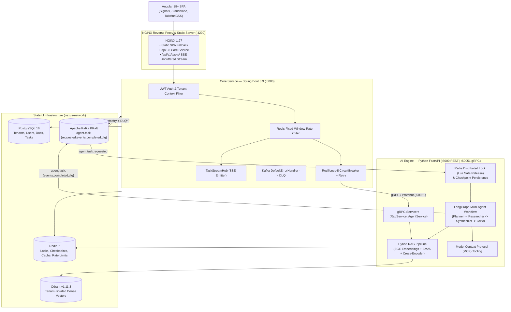

# NexusEnterprise Hub

**Production Multi-Tenant Enterprise AI Platform** combining **Angular 18+** (Signals + TailwindCSS), **Spring Boot 3.3** (JWT Multi-Tenancy + Resilience4j + SSE), and **Python FastAPI / LangGraph** (Hybrid RAG + Cross-Encoder Reranking + MCP + Distributed Redis Coordination) over **gRPC/Protobuf** and **Apache Kafka (KRaft)**.

---

## System Architecture



---

## Tech Stack Matrix

| Layer | Technologies & Patterns |
| :--- | :--- |
| **Frontend Gateway** | Angular 18+ (Standalone Components, Signals, `inject()`, Functional Guards/Interceptors), TailwindCSS, Lucide Icons, NGINX 1.27 (SSE-unbuffered proxy) |
| **Core Backend** | Java 21, Spring Boot 3.3, Spring Security (Stateless JWT + `?token=` SSE auth), Flyway Migrations, Spring Data JPA, Resilience4j (`CircuitBreaker` + `Retry`), Spring Kafka |
| **AI & ML Engine** | Python 3.11, FastAPI, LangGraph, LangChain, Model Context Protocol (`mcp`), `sentence-transformers` (`BAAI/bge-small-en-v1.5`, `cross-encoder/ms-marco-MiniLM-L-6-v2`), `rank-bm25`, `aiokafka` |
| **Inter-Service RPC** | Protocol Buffers (`proto/ai/v1/*.proto`) & bidirectional/server-streaming gRPC (`50051`) |
| **Messaging & Fault Tolerance** | Apache Kafka 7.6.1 (KRaft, 3 partitions/topic), Explicit offset commits, Exponential backoff + `agent.task.dlq` routing, Distributed Redis Task Locks |
| **Storage & Caching** | PostgreSQL 16, Qdrant v1.11.3, Redis 7 (`Rate Limiter`, `Distributed Locks`, `LangGraph Checkpoints`, `Hybrid Search Cache`) |
| **CI/CD & Packaging** | Multi-stage Docker builds, Docker Compose (8-container stack), Makefile automation, Path-filtered GitHub Actions |

---

## Quickstart Guide

### Prerequisites
- Docker Engine & Docker Compose v2+
- Minimum 6 GB RAM allocated to Docker (for JVM, Kafka KRaft, Qdrant, and HuggingFace neural models)

### 1. One-Command Production Launch

```bash
# Optional: customize secrets in .env (auto-generated from .env.example if omitted)
cp .env.example .env

# Build all multi-stage images and launch the 8-service stack
docker compose --env-file .env -f deploy/docker-compose.yml up -d --build
```

Or using `make`:
```bash
make up
```

### 2. Service & Ports Map

| Service | Container Name | Host Port(s) | Purpose / Health Endpoint |
| :--- | :--- | :--- | :--- |
| **Frontend + NGINX** | `nexus-frontend` | `4200` | Angular UI & API/SSE Gateway (`http://localhost:4200/nginx-health`) |
| **Core Service** | `nexus-core-service` | `8080` | REST API, JWT Auth, SSE Hub, Actuator (`http://localhost:8080/actuator/health`) |
| **AI Service** | `nexus-ai-service` | `8000`, `50051` | FastAPI REST (`http://localhost:8000/healthz`) & gRPC Server |
| **PostgreSQL 16** | `nexus-postgres` | `5432` | Relational persistence (`nexus_db`, schema `core`) |
| **Redis 7** | `nexus-redis` | `6379` | Distributed locking, rate limiting, checkpoints, caching |
| **Qdrant** | `nexus-qdrant` | `6333`, `6334` | Vector DB dashboard (`http://localhost:6333/dashboard`) & gRPC |
| **Apache Kafka** | `nexus-kafka` | `9092` | KRaft event broker (`agent.task.requested`, `.events`, `.completed`, `.dlq`) |
| **Kafka Init** | `nexus-kafka-init` | — | Idempotent startup topic provisioner |

### 3. Authentication & Demo Workspace Access

1. Open **`http://localhost:4200`** in your browser.
2. On first launch (clean database), click **Create Organization / Register** or register via API to provision your tenant and user account (e.g. demo credentials `bob@techcorp.io` / `ProductionPassword2026!`, Organization `TechCorp`), or sign in if your PostgreSQL volume already contains your seeded tenant:

```bash
curl -X POST http://localhost:4200/api/v1/auth/register \
  -H "Content-Type: application/json" \
  -d '{
    "organizationName": "TechCorp",
    "fullName": "Bob Architect",
    "email": "bob@techcorp.io",
    "password": "ProductionPassword2026!"
  }'
```

---

## End-to-End Platform Workflow

### Step 1 — Multi-Tenant Document Ingestion (`Knowledge Base`)
1. Navigate to **Knowledge Base** in the Angular UI (or `POST /api/v1/documents/upload`).
2. `core-service` validates the tenant quota (`TenantRateLimitFilter` in Redis), persists file bytes to the shared Docker volume (`/shared-uploads`), saves metadata in PostgreSQL, and invokes `RagGrpcClient.ingestDocument(...)` protected by Resilience4j (`aiServiceGrpc` circuit breaker + `aiServiceRetry`).
3. `ai-service` chunks the PDF/text, generates 384-d `BAAI/bge-small-en-v1.5` embeddings, and upserts vectors into Qdrant tagged with `tenant_id` for strict cross-tenant isolation.

### Step 2 — Hybrid Vector + Lexical Search & Cross-Encoder Reranking
1. Query the Knowledge Base (`POST /api/v1/documents/search`) with `topK`, `alpha` (dense/sparse blend), and `rerank: true`.
2. `ai-service` checks Redis cache (`rag:search:{tenant}:{hash}`), retrieves top-N semantic vectors from Qdrant filtered by `tenant_id`, combines them with BM25 lexical scoring, and re-scores candidates with `cross-encoder/ms-marco-MiniLM-L-6-v2`.

### Step 3 — Multi-Agent LangGraph Orchestration & Real-Time SSE Streaming (`Agent Studio`)
1. Submit a task (`DEEP_RESEARCH` or `DOCUMENT_ANALYSIS`) via **Agent Studio** (`POST /api/v1/tasks`).
2. `core-service` stores the task as `PENDING` and publishes `AgentTaskRequestedEvent` to Kafka topic `agent.task.requested`.
3. The Angular UI opens an `EventSource` stream to `/api/v1/tasks/{taskId}/stream?token={jwt}`, proxied unbuffered through NGINX.
4. `ai-service` consumes the Kafka record, acquires a Lua-guarded Redis distributed lock (`lock:task:{taskId}`) to prevent duplicate execution, persists state checkpoints in Redis, and runs the 4-node LangGraph pipeline (`PLANNER` -> `RESEARCHER` -> `SYNTHESIZER` -> `CRITIC`) equipped with MCP tools.
5. Node telemetry streams live via `agent.task.events` -> `core-service` `TaskStreamHub` -> NGINX SSE -> Angular Signals dashboard, concluding with `agent.task.completed` (or automatic `agent.task.dlq` routing on poison-pill errors).

---

## Development & Verification Commands

```bash
make up             # Build and start full 8-service production stack
make status         # Show running containers and health status
make logs           # Tail combined container logs
make down           # Stop stack (preserves persistent volumes)
make test-all       # Run Core Service Maven tests, AI Service pytest, & Frontend build
```
