# NexusEnterprise Hub — Technical Architecture Guide

> **Scope.** This guide describes the system exactly as implemented on `main` after the Sprint 1 and
> Sprint 2 hardening work (commit `6cf259b`). Every port, topic, key, class and file referenced here
> exists in the repository. Diagrams use [Mermaid](https://mermaid.js.org/) and render natively on GitHub.

**Contents**

1. [System Overview & Full Topology](#1-system-overview--full-topology)
2. [Complete Repository Map](#2-complete-repository-map)
3. [Technology Stack & Why We Chose It](#3-technology-stack--why-we-chose-it)
4. [End-to-End Wiring & Data Flows](#4-end-to-end-wiring--data-flows)
5. [Security, Resilience & AI QA Architecture](#5-security-resilience--ai-qa-architecture)
6. [API, gRPC, Kafka, Redis & Database Reference](#6-api-grpc-kafka-redis--database-reference)
7. [Verification Evidence & Known Limitations](#7-verification-evidence--known-limitations)

---

## 1. System Overview & Full Topology

NexusEnterprise Hub is a multi-tenant **RAG + multi-agent research platform**. A browser talks only to
an NGINX gateway. A Spring Boot **core-service** owns identity, tenancy, persistence and the public REST/SSE
API. A Python **ai-service** owns parsing, embeddings, hybrid retrieval, MCP tools and the LangGraph agent
workflow. The two services communicate synchronously over **gRPC** (search, vector deletion, MCP discovery)
and asynchronously over **Kafka** (document ingestion, agent tasks, telemetry).

### 1.1 Container topology

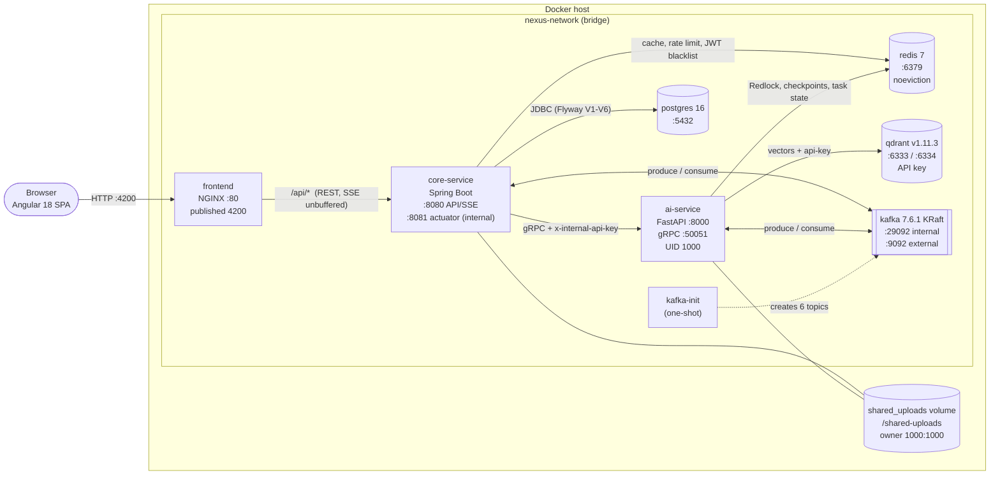

### 1.2 Port exposure matrix

| Service | Container port(s) | Base `docker-compose.yml` | Dev `docker-compose.override.yml` |
|---|---|---|---|
| `frontend` (NGINX) | 80 | **`0.0.0.0:4200 → 80`** (only public port) | unchanged |
| `core-service` | 8080 (API), 8081 (actuator) | not published | `127.0.0.1:8080` (8081 never published) |
| `ai-service` | 8000 (HTTP), 50051 (gRPC) | not published | `127.0.0.1:8000`, `127.0.0.1:50051` |
| `postgres` | 5432 | not published | `127.0.0.1:5432` |
| `redis` | 6379 | not published | `127.0.0.1:6379` |
| `qdrant` | 6333 (HTTP), 6334 (gRPC) | not published | `127.0.0.1:6333`, `127.0.0.1:6334` |
| `kafka` | 29092 (in-network), 9092 (external listener), 9093 (controller) | not published | `127.0.0.1:9092` |
| `kafka-init` | — | runs `create-topics.sh` once and exits | — |

### 1.3 Trust boundaries

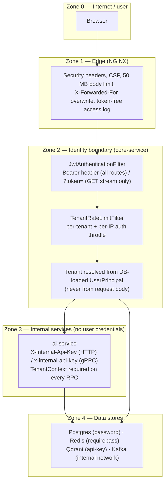

**Startup ordering** (from `depends_on` conditions): `postgres`, `redis`, `qdrant`, `kafka` must be
`service_healthy`; `kafka-init` must reach `service_completed_successfully`; `ai-service` must be healthy
(`GET /healthz`) before `core-service` starts; `core-service` must be healthy
(`GET :8081/actuator/health`) before `frontend` starts.

---

## 2. Complete Repository Map

### 2.1 Root, contracts & deployment

| Path | Responsibility |
|---|---|
| `.env.example` | Template of every variable; required secrets (`POSTGRES_PASSWORD`, `REDIS_PASSWORD`, `QDRANT_API_KEY`, `JWT_SECRET`, `INTERNAL_API_KEY`) are `change-me` placeholders; optional `LLM_*`. |
| `.gitignore` / `.dockerignore` | Excludes `.env`, build outputs (`target/`, `dist/`, `node_modules/`) and generated eval reports. |
| `Makefile` | `up`/`down`/`logs`/`status` (base + override compose), `core-test` (Maven in Docker), `ai-test`/`ai-eval` (dev image), `frontend-build`, `proto`; `check-env` refuses to start with placeholder secrets. |
| `README.md` | Project overview, quick start and links to this guide and the User Guide. |
| `proto/ai/common.proto` | Shared messages: `TenantContext{tenant_id,user_id,trace_id,roles}`, pagination, `ErrorDetail`, `Empty`. |
| `proto/ai/v1/rag_service.proto` | `RagService`: `IngestDocument`, `HybridSearch`, `DeleteDocumentVectors`. |
| `proto/ai/v1/agent_service.proto` | `AgentService`: `ExecuteAgentSync`, `StreamAgentWorkflow`, `ListMcpTools`; `NodeType`/`EventPhase` enums. |
| `scripts/compile-proto.sh` | Regenerates committed Python stubs in a container with **pinned `grpcio-tools==1.84.0`** and patches import paths. |
| `scripts/test-proto.py` | Smoke test that the generated Python stubs import and serialize. |
| `deploy/docker-compose.yml` | Production-shaped stack: 8 services, required secrets (`${VAR:?}`), only the gateway published, healthchecks & ordering. |
| `deploy/docker-compose.override.yml` | Local-dev port bindings, all on `127.0.0.1`. |
| `deploy/init-scripts/kafka/create-topics.sh` | Idempotently creates the 6 topics (3 partitions, RF 1, 7-day retention). |
| `deploy/init-scripts/postgres/01-init-databases.sql` | First-boot database/schema bootstrap for PostgreSQL. |

### 2.2 `services/core-service` (Java 21 / Spring Boot 3.3.4)

| Path | Responsibility |
|---|---|
| `pom.xml` | Dependencies (Spring Web/Security/Data JPA/Redis/Kafka, Flyway, Resilience4j, gRPC 1.64, protobuf 3.25) and `protobuf-maven-plugin` compiling `../../proto`. |
| `Dockerfile` | Multi-stage: Maven build → `eclipse-temurin:21-jre-alpine`, user `nexus` UID/GID 1000, `/shared-uploads` owned 1000:1000, healthcheck on `:8081`. |
| `Dockerfile.fast` | Runtime-only image from a prebuilt `target/*.jar` (same user/healthcheck). |
| `NexusHubApplication.java` | Boot entry point; `@EnableScheduling` for SSE heartbeats. |
| `common/GlobalExceptionHandler.java` | Maps exceptions to `ApiResponse` errors: 400/401/403/404/413; generic 500s log server-side and return only a `traceId`. |
| `common/dto/ApiResponse.java` | Uniform envelope `{success, message, data, timestamp}`. |
| `common/exception/*` | `ApiException` hierarchy incl. `AiServiceUnavailableException` (503) and `AiServiceTimeoutException` (504). |
| `config/GrpcClientConfig.java` | Managed gRPC channel to `ai-service:50051`; client interceptor attaching `x-internal-api-key` to every call; fails startup if the key is blank. |
| `config/KafkaConsumerConfig.java` | Listener container factory (concurrency 3), `ErrorHandlingDeserializer`, exponential backoff, DLQ recoverer → `agent.task.dlq`. |
| `config/KafkaProducerConfig.java` | Idempotent JSON producer (`acks=all`). |
| `config/RedisConfig.java` | Redis cache manager: default TTL 10 min, `tasks_cache` 30 s, `documents_cache` 5 min. |
| `grpc/client/RagGrpcClient.java` | `HybridSearch` and `DeleteDocumentVectors` with `@CircuitBreaker(aiServiceGrpc)` + `@Retry(aiServiceRetry)` and deadlines; orphan-vector cleanup entry point. |
| `grpc/client/AgentGrpcClient.java` | `ListMcpTools` (plus sync/stream RPC wrappers) with the same resilience policies. |
| `grpc/client/GrpcContextHelper.java` | Builds `TenantContext` from the authenticated principal (throws if absent); explicit `buildSystemTenantContext(tenantId)` only for background cleanup. |
| `kafka/producer/AgentTaskProducer.java` | Publishes `agent.task.requested` (key = taskId). |
| `kafka/producer/DocumentIngestProducer.java` | Publishes `document.ingest.requested` (key = documentId). |
| `kafka/consumer/AgentTaskTelemetryConsumer.java` | Consumes `agent.task.events` / `agent.task.completed`; persists audit events & final state; broadcasts SSE; evicts tenant-scoped task cache. |
| `kafka/consumer/DocumentIngestCompletedConsumer.java` | Consumes `document.ingest.completed`; conditional `INDEXING → INDEXED/FAILED` update; evicts `documents_cache`; purges vectors of documents deleted mid-indexing. |
| `kafka/event/*` | Kafka payload DTOs (`AgentTaskRequestedEvent`, `TaskProgressEventDto`, `TaskCompletedEventDto`, `DocumentIngestRequestedEvent`, `DocumentIngestCompletedEventDto`). |
| `modules/auth/*` | `AuthController` (`register`, `login`, `logout`, `me`), `AuthService` (BCrypt, tenant + owner creation as `ADMIN`), DTOs. |
| `modules/document/controller/DocumentController.java` | Upload (202), hybrid search, list, delete. |
| `modules/document/service/DocumentService.java` | Validation, disk write `/shared-uploads/{tenant}/{documentId}_{name}`, row insert as `INDEXING`, search, delete across disk/DB/Qdrant/cache. |
| `modules/document/service/DocumentFileValidator.java` | Extension allowlist (`.pdf .txt .md .docx`) + magic bytes (`%PDF-`, `PK\x03\x04`, UTF-8 without NUL). |
| `modules/document/service/DocumentIngestDispatchListener.java` | `@TransactionalEventListener(AFTER_COMMIT)`: sends `document.ingest.requested`, waits for the ack, marks `FAILED` on send failure. |
| `modules/document/event/DocumentUploadedEvent.java` | In-process Spring event raised inside the insert transaction. |
| `modules/task/controller/TaskController.java` | Create (202), get, list (paged), SSE stream; ownership checked before returning data or registering an emitter. |
| `modules/task/service/TaskService.java` | Task persistence, tenant-keyed cache (`{tenantId}:{taskId}`), `TaskCreatedEvent`, `markDispatchFailed`. |
| `modules/task/service/TaskDispatchListener.java` | AFTER_COMMIT publisher for `agent.task.requested`. |
| `modules/task/service/TaskStreamHub.java` | In-memory SSE emitter registry; handshake, broadcast, completion, **15 s `: keep-alive` heartbeat**. |
| `modules/task/entity/*` | JPA entities `AgentTask`, `Document` (assigned id via `Persistable<UUID>`), `TaskAuditEvent`; enums `TaskStatus`, `TaskType`, `DocumentStatus`. |
| `modules/task/repository/*` | Spring Data repositories incl. `DocumentRepository.transitionStatus` conditional update. |
| `modules/tenant/*`, `modules/user/*` | `Tenant`, `User`, `Role {ADMIN, ANALYST, VIEWER, PLATFORM_OPERATOR}` and repositories. |
| `security/SecurityConfig.java` | Stateless filter chain, CORS, public routes, `/actuator/health/**` public, other actuator → `PLATFORM_OPERATOR`. |
| `security/JwtService.java` | HS256 sign/verify (key ≥ 32 bytes), 24 h expiry. |
| `security/JwtAuthenticationFilter.java` | Bearer header everywhere; `?token=` **only** for `GET /api/v1/tasks/{id}/stream`; revocation check fails closed (503). |
| `security/TokenRevocationService.java` | Redis blacklist `jwt:blacklist:{sha256}` with TTL = remaining token lifetime; throws on Redis failure. |
| `security/TenantRateLimitFilter.java` | Atomic Lua INCR+EXPIRE: 30 req/min per tenant on `POST /tasks` & `POST /documents/upload`; 10 req/min per IP on `POST /auth/login|register`; HTTP 429 + `Retry-After`. |
| `security/UserPrincipal.java` | Authenticated principal carrying `tenantId`, user id and authorities. |
| `resources/application.yml` | All configuration (see §6.6); secrets have no defaults. |
| `resources/db/migration/V1..V6` | Flyway schema history (see §6.5). |
| `src/test/**` | 13 test classes / **94 tests** (tenant cache isolation, after-commit dispatch, ingest consumer, file validator, JWT/revocation, actuator, heartbeat, resilience, telemetry). |

### 2.3 `services/ai-service` (Python 3.11 / FastAPI)

| Path | Responsibility |
|---|---|
| `Dockerfile` | `base` (torch CPU, runtime deps, pre-cached HF models in `/opt/hf-cache`) → `dev` (tests/evals) → `runtime` (non-root `nexus` UID 1000). |
| `requirements.txt` / `requirements-dev.txt` | Runtime-only pins (e.g. `qdrant-client<1.12` to match server 1.11) vs test/eval/lint tooling. |
| `pytest.ini` | `pythonpath = .`, `testpaths = tests`. |
| `app/main.py` | FastAPI app + lifespan (Qdrant init, model warm-up, MCP manager, Kafka producer, task & ingest consumers, gRPC server); `InternalApiKeyMiddleware`; internal REST endpoints. |
| `app/core/config.py` | Pydantic settings: required `INTERNAL_API_KEY`, Qdrant, Redis, Kafka topics, LLM settings, collection allowlist, MCP allowed hosts. |
| `app/security/auth.py` | Constant-time key check, pure-ASGI HTTP middleware, async gRPC `ServerInterceptor`, `require_tenant_id` validation. |
| `app/security/guardrails.py` | Regex guardrails for prompt injection, jailbreak and data-exfiltration prompts with a safe refusal. |
| `app/grpc/server.py` | `grpc.aio` server on :50051 with the internal-key interceptor. |
| `app/grpc/servicers/rag_servicer.py` | `IngestDocument` (legacy sync, shares the pipeline), `HybridSearch`, `DeleteDocumentVectors` with exact counts. |
| `app/grpc/servicers/agent_servicer.py` | `ListMcpTools` (allowlisted tools, tenant_id hidden from schemas), `ExecuteAgentSync` (allowlist + injected tenant), `StreamAgentWorkflow`. |
| `app/grpc/generated/**` | Committed stubs generated from `proto/` (CI verifies they match). |
| `app/kafka/consumer.py` | `agent.task.requested` consumer: Redlock `lock:task:{id}`, LangGraph streaming, progress/completion events with real durations, DLQ. |
| `app/kafka/ingest_consumer.py` | `document.ingest.requested` consumer: Redlock `lock:doc:{id}`, `asyncio.to_thread(ingest_document)`, `document.ingest.completed`, DLQ. |
| `app/kafka/producer.py` | Idempotent producer for events, completions, ingest outcomes and DLQ records. |
| `app/rag/ingestion.py` | Shared pipeline: tenant-sandboxed path resolution, parse → embed (batches of 256) → upsert (batches of 100), deleted-during-ingest purge. |
| `app/rag/parser.py` | Text extraction (pypdf for PDFs, raw text otherwise) + `RecursiveCharacterTextSplitter` chunking with citations. |
| `app/rag/embeddings.py` | `SentenceTransformer("BAAI/bge-small-en-v1.5")`, 384-dim. |
| `app/rag/retriever.py` | Dense Qdrant search with mandatory `tenant_id` filter + BM25 over candidates + alpha fusion + optional reranking. |
| `app/rag/reranker.py` | `CrossEncoder("cross-encoder/ms-marco-MiniLM-L-6-v2")` reranking. |
| `app/db/qdrant.py` | Qdrant clients (with API key) and idempotent collection + keyword payload indexes (`tenant_id`, `document_id`). |
| `app/db/redis.py` | Async/sync clients, `DistributedTaskLock` (SET NX EX + Lua release/renew heartbeat), `distributed_lock`, task-state store. |
| `app/agents/graph.py` | LangGraph `StateGraph`: planner → researcher → synthesizer → critic → (planner \| END) bounded by `MAX_AGENT_ITERATIONS`; `RedisSaver` checkpointer. |
| `app/agents/state.py` | `AgentWorkflowState` TypedDict (+ `errors`, `token_usage`, `llm_mode`) and `build_initial_state`. |
| `app/agents/llm.py` | Optional OpenAI-compatible `ChatOpenAI` client (`LLM_API_KEY`, `LLM_BASE_URL`, `LLM_MODEL`), `invoke_llm`, JSON parsing. |
| `app/agents/text_utils.py` | Keyword extraction and query de-duplication for the deterministic mode. |
| `app/agents/nodes/planner.py` | Guardrail check, LLM or deterministic query plan, critique-driven re-planning. |
| `app/agents/nodes/researcher.py` | Runs planned queries verbatim via hybrid search (off the event loop) + tenant-scoped MCP file inventory; records errors. |
| `app/agents/nodes/synthesizer.py` | LLM answer with `[^n]` citations, or honest extractive report; references and retrieval issues sections. |
| `app/agents/nodes/critic.py` | Structural audit (citations, dangling footnotes, term coverage) + optional LLM fact-check. |
| `app/agents/redis_checkpointer.py` | `agent:checkpoint:{taskId}` (+ `:history`) with 24 h TTL. |
| `app/mcp/server.py` | Native MCP server (`nexus_hybrid_search`, `nexus_document_summarizer`), SSE app with DNS-rebinding protection. |
| `app/mcp/servers/filesystem_server.py` | stdio MCP server: `list_shared_files`, `read_shared_file_preview`, sandboxed to `/shared-uploads/{tenant_id}` (realpath + commonpath). |
| `app/mcp/tenant_tools.py` | Allowlist of 4 tenant-callable tools, path-argument validation (→ 400), server-side tenant injection. |
| `app/mcp/client_manager.py` | Connects to configured MCP servers (stdio/SSE), discovers and calls tools. |
| `app/mcp/tool_adapter.py` | Converts MCP tool schemas into LangChain `StructuredTool`s. |
| `app/mcp/configs/mcp_servers.json` | `enterprise_filesystem` (stdio) and `enterprise_analytics` (internal SSE loopback). |
| `tests/*.py` | 42 unit/security/integration tests (ingest, DLQ, MCP, agent graph, auth, path traversal). |
| `tests/evals/*` | RAGAS, DeepEval and Giskard suites over `golden_dataset.json` (5 tests). |

### 2.4 `services/frontend` (Angular 18 + NGINX)

| Path | Responsibility |
|---|---|
| `Dockerfile` | `node:20` build → `nginx:1.27-alpine` serving `dist/frontend/browser` with `nginx.conf`. |
| `nginx.conf` | Gateway: `main_noquery` log format, security headers/CSP, SSE location (`proxy_buffering off`, 3600 s), `/api/` proxy, cache policy, SPA fallback, `/nginx-health`. |
| `angular.json`, `karma.conf.js`, `tsconfig*.json`, `tailwind.config.js` | Build (production `inlineCritical: false` for strict CSP), test runner (`ChromeHeadlessCI`), TypeScript and Tailwind configuration. |
| `src/app/app.routes.ts` | Routes: `/auth/login`, `/auth/register`, guarded shell with `/dashboard`, `/knowledge-base`, `/agent-studio`. |
| `src/app/app.config.ts` | Providers: router, HTTP client with `authInterceptor` + `errorInterceptor`. |
| `core/guards/auth.guard.ts` | Redirects unauthenticated users to login. |
| `core/interceptors/auth.interceptor.ts` | Adds `Authorization: Bearer` to `/api/*` requests. |
| `core/interceptors/error.interceptor.ts` | Logs out **only on 401**; toasts for 403/429/5xx/network; `SILENT_HTTP_ERRORS` flag for polling. |
| `core/services/auth.service.ts` | Signal-based session (token, user), login/register/logout, `me`. |
| `core/services/document.service.ts` | Upload (202 → `INDEXING` row), list (optionally background), search, delete. |
| `core/services/agent-studio.service.ts` | Task submit/list, `EventSource` SSE handling, report/citation state, `totalTasks`. |
| `core/services/notification.service.ts` + `core/components/toast-container.component.ts` | De-duplicated signal toasts. |
| `core/layout/shell.component.ts` | Sidebar, tenant pill, live Online/Degraded/Offline indicator (polls `/nginx-health` + `/api/v1/auth/me` every 30 s). |
| `features/auth/*` | Login and organization registration screens. |
| `features/dashboard/dashboard.component.ts` | KPIs (documents, tasks via `totalItems`), recent activity. |
| `features/knowledge-base/knowledge-base.component.ts` | Upload zone, chunk settings, document table with 3 s polling while indexing, hybrid search playground. |
| `features/agent-studio/agent-studio.component.ts` | Prompt composer, task type, document grounding, MCP registry, 4-stage pipeline, thought stream, report & citations. |
| `*.spec.ts` | 19 Karma/Jasmine specs (interceptors, SSE service). |

### 2.5 `.github/workflows`

| Workflow | Jobs |
|---|---|
| `ci-core-service.yml` | `build-and-test` (JDK 21, proto compile + `mvn test`, 20 min) · `docker-build` (full Dockerfile, 25 min). |
| `ci-ai-service.yml` | `lint-and-test` (uv + HF cache, **proto drift check**, ruff, unit tests, offline evals, report artifact; 45 min). |
| `ci-frontend.yml` | `build` (npm ci, Karma ChromeHeadless, `ng build`; 15 min) · `docker` (image build + `nginx -t`; 15 min). |

All workflows declare `permissions: contents: read` and per-ref `concurrency` with `cancel-in-progress`.

---

## 3. Technology Stack & Why We Chose It

| Layer | Technology | Where | Why |
|---|---|---|---|
| Core API | **Java 21, Spring Boot 3.3.4** | core-service | Mature security, transactions (`@TransactionalEventListener`), JPA and Kafka integration; virtual-thread-ready JVM. |
| Schema | **Flyway V1–V6** + Hibernate `ddl-auto: validate` | core-service | Versioned, reviewable migrations; app refuses to start on schema drift. |
| AI runtime | **Python 3.11, FastAPI, uvicorn** | ai-service | The ML ecosystem (sentence-transformers, LangGraph, MCP SDK) is Python-first; FastAPI gives async I/O and typed validation. |
| Service contract | **Protobuf + gRPC** (`grpc.aio`) | proto/, both services | Strongly typed, versioned contract with code generation for Java and Python; HTTP/2 multiplexing and deadlines. |
| Messaging | **Apache Kafka 7.6.1 (KRaft)** | kafka | Durable, replayable async work queues (ingestion, agents) and telemetry; no ZooKeeper; DLQ support. |
| Relational DB | **PostgreSQL 16** | postgres | ACID system of record for tenants, users, documents, tasks and audit events; JSONB for payloads. |
| Cache / coordination | **Redis 7 (`noeviction`)** | redis | Response cache, rate-limit counters, JWT blacklist, Redlock and LangGraph checkpoints; `noeviction` guarantees security keys are never silently evicted. |
| Vector DB | **Qdrant v1.11.3** | qdrant | Fast filtered ANN search with keyword payload indexes for strict `tenant_id` isolation; API-key protected. |
| Embeddings | **`BAAI/bge-small-en-v1.5`** (384-d) | ai-service | Strong retrieval quality for its size; runs on CPU; pre-cached in the image. |
| Sparse retrieval | **BM25 (`rank-bm25`)** | retriever.py | Exact-term recall (codes, IDs, numbers) that dense vectors miss; fused with dense scores via `alpha`. |
| Reranking | **`cross-encoder/ms-marco-MiniLM-L-6-v2`** | reranker.py | Cross-attention relevance scoring of the top candidates; large precision gain for small latency. |
| Tool protocol | **MCP (`mcp` 2.x) over stdio & SSE** | app/mcp | Standard, pluggable tool interface for agents; stdio isolates the filesystem tool in a subprocess. |
| Agent framework | **LangGraph + LangChain core** | app/agents | Explicit, inspectable state machine with conditional edges, streaming and checkpointing. |
| LLM (optional) | **OpenAI-compatible `ChatOpenAI`** | llm.py | Works with OpenAI, Groq, Ollama or vLLM through `LLM_BASE_URL`; honest deterministic fallback without a key. |
| Fault tolerance | **Resilience4j** circuit breaker + retry | core-service | Fast failure and self-healing when ai-service is degraded; health exposed on the internal actuator. |
| Frontend | **Angular 18 (standalone, Signals), Tailwind** | frontend | Typed SPA with fine-grained reactivity; `EventSource` for live telemetry. |
| Gateway | **NGINX 1.27** | frontend | Static hosting, reverse proxy, unbuffered SSE, security headers, token-free logging. |
| AI QA | **RAGAS, DeepEval, Giskard** | tests/evals | Retrieval quality, hallucination/relevancy and red-team robustness, offline on CPU or with an LLM judge. |
| CI/CD | **GitHub Actions** | .github/workflows | Per-service pipelines with drift checks, image builds and config validation. |

---

## 4. End-to-End Wiring & Data Flows

### Flow A — Authentication & multi-tenancy

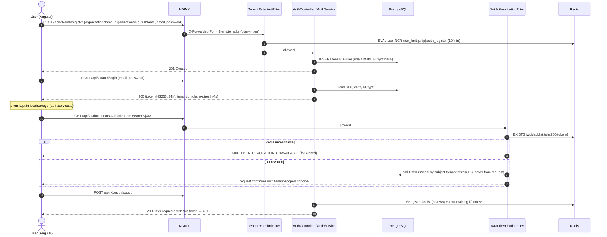

**`?token=` rule.** `EventSource` cannot set headers, so the JWT may be passed as a query parameter
**only** for `GET /api/v1/tasks/{id}/stream`. Anywhere else the query token is ignored (→ 401). NGINX logs
`$uri` (never `$args`) and raises the stream location's `error_log` to `crit`, so tokens never reach logs.

**Tenant isolation across stores.**

| Store | Isolation mechanism |
|---|---|
| PostgreSQL | Every query is scoped by the principal's `tenantId` (`findByIdAndTenantId`, `findByTenantId…`); ownership re-checked in `TaskController` (404 on mismatch). |
| Redis cache | `tasks_cache` key `{tenantId}:{taskId}`; `documents_cache` key `{tenantId}`. |
| Qdrant | Every point payload has `tenant_id`; every search/delete adds a mandatory `tenant_id` must-filter. |
| Filesystem | Files live in `/shared-uploads/{tenantId}/`; ingestion and MCP tools resolve with `realpath` + `commonpath` against that root. |
| gRPC / MCP | `TenantContext.tenant_id` is required and validated (`^[A-Za-z0-9][A-Za-z0-9_-]{0,63}$`); tool arguments' `tenant_id` is overwritten server-side. |
| Kafka | Messages carry `tenantId`; consumers reject invalid tenants; completion updates require tenant match. |

### Flow B — Asynchronous document ingestion

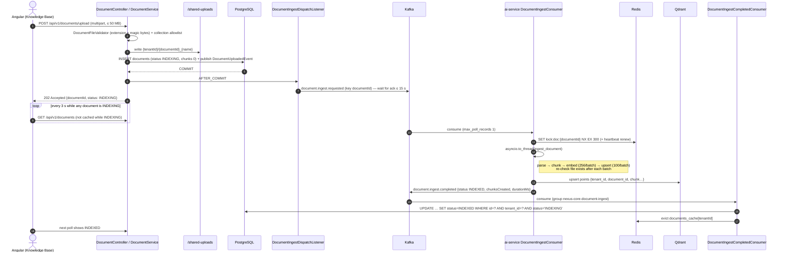

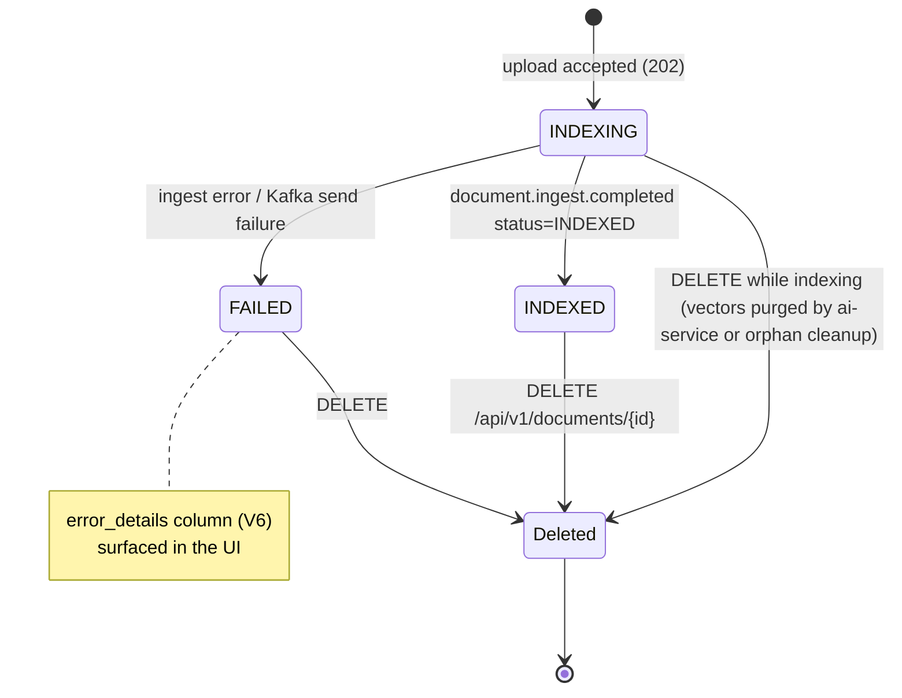

**Failure handling.** Invalid payload / tenant / path, missing file or "deleted during indexing" →
`FAILED` outcome + DLQ record. If the document disappears while vectors are being written, ai-service purges
them; if an `INDEXED` event arrives for a deleted row, `DocumentIngestCompletedConsumer` calls
`DeleteDocumentVectors` with a system `TenantContext`. Duplicate deliveries are harmless (Redlock + idempotent
point ids `uuid5(tenant:chunk_id)` + conditional status update).

### Flow C — Synchronous hybrid search & reranking

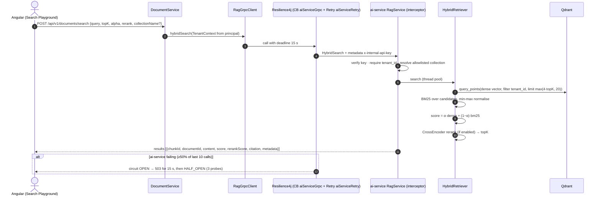

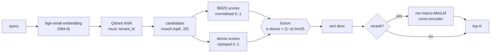

### Flow D — Multi-agent orchestration & live SSE telemetry

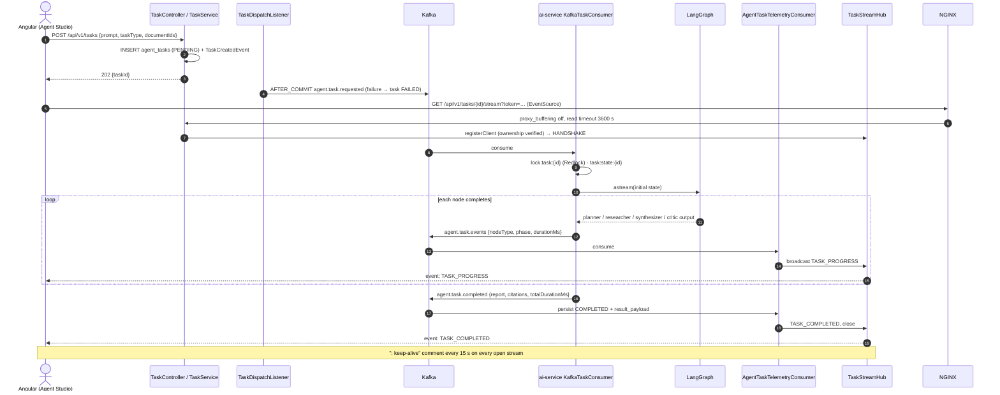

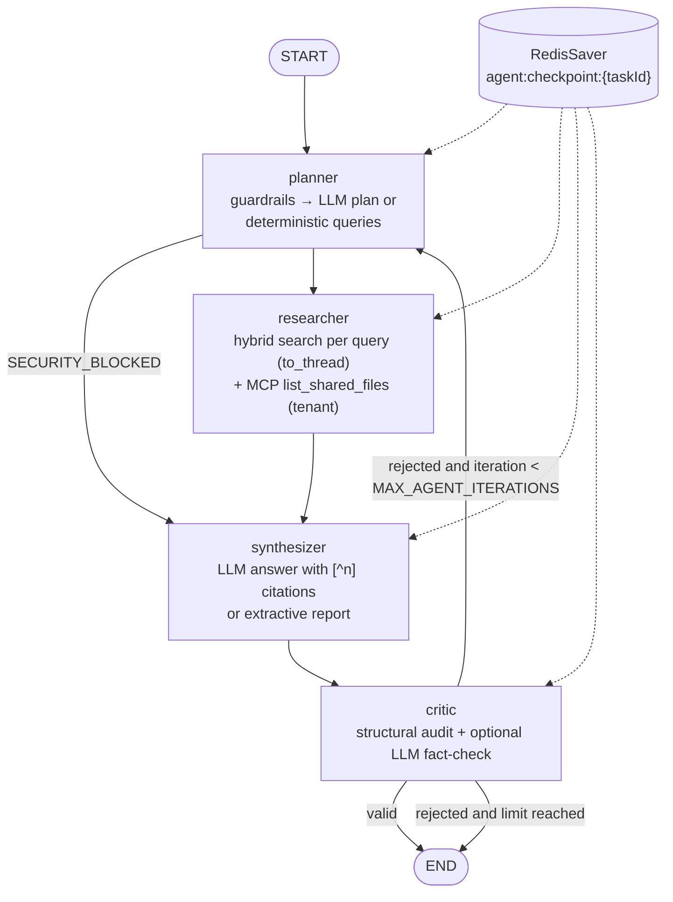

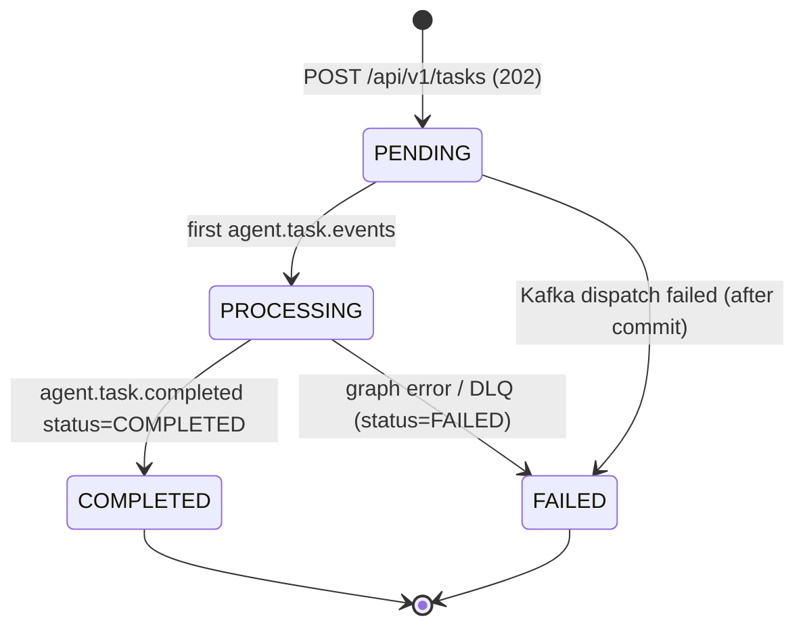

**LLM vs deterministic mode.** With `LLM_API_KEY` set, planner/synthesizer/critic call the configured model
(`ainvoke`) and `token_usage` is accumulated from provider metadata. Without it, the planner uses the question
plus keyword variants, the synthesizer returns ranked verbatim excerpts with an explicit
"_Deterministic mode: no language model was used_" banner, the critic runs only structural checks, and
`token_usage` stays 0. LLM failures degrade to the deterministic path and are recorded in `errors`.

### Flow E — Document deletion & zero-orphan cleanup

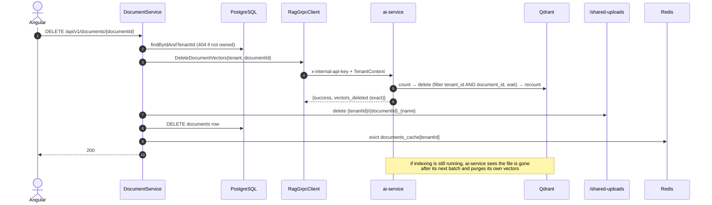

The same `documentId` is the file name prefix, the PostgreSQL primary key (assigned, not generated — the
`Persistable<UUID>` fix) and the Qdrant `document_id` payload, which is what makes zero-orphan deletion possible.

### 4.6 Kafka topic map

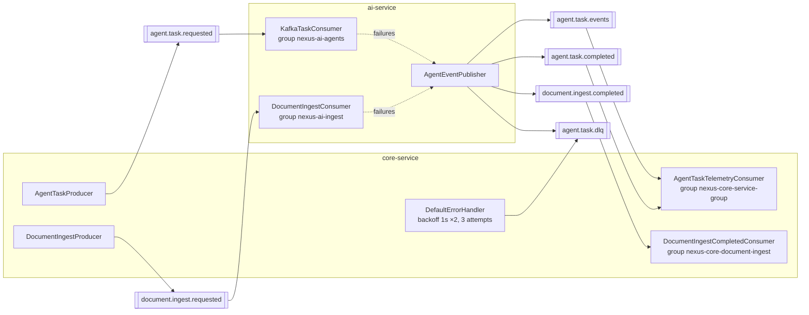

---

## 5. Security, Resilience & AI QA Architecture

### 5.1 Security control matrix

| # | Control | Implementation | Verified by |
|---|---|---|---|
| 1 | Edge exposure | Only NGINX published (4200); dev ports bound to `127.0.0.1` | live: actuator 8081 unreachable from host |
| 2 | User authentication | HS256 JWT (24 h), BCrypt passwords, stateless sessions | `JwtFilterAndRevocationTest` |
| 3 | Token revocation | Redis `jwt:blacklist:{sha256}`, TTL = remaining lifetime, **fail closed (503)** | live: revoked token → 401 |
| 4 | Query-token scope | `?token=` only on `GET /api/v1/tasks/{id}/stream` | live: `?token=` on `/documents` → 401 |
| 5 | Tenant isolation | DB-derived tenant, tenant-keyed caches, Qdrant filters, sandboxed paths | `TaskTenantCacheIsolationTest`; live cross-tenant → 404 |
| 6 | Service-to-service auth | `INTERNAL_API_KEY` on all ai-service HTTP (except `/healthz`, `/readyz`) and gRPC | live: 401 / `UNAUTHENTICATED` without key |
| 7 | Tool allowlist | 4 tenant-callable MCP tools; others → 403 / `PERMISSION_DENIED` | `test_mcp_integration.py` |
| 8 | Path traversal | Pre-validation (→ 400) + realpath/commonpath sandbox + symlink checks | `test_security_and_agents.py`; live → 400 |
| 9 | MCP DNS rebinding | `TransportSecuritySettings` allowed hosts (`ai-service:*`, `localhost:*` …) | config |
| 10 | Datastore auth | Postgres password, Redis `requirepass`, Qdrant `api-key`; no secret defaults | live: Qdrant without key → 401 |
| 11 | Actuator isolation | Management port 8081 (internal only); non-health endpoints require `PLATFORM_OPERATOR` (never self-assigned) | `ActuatorSecurityTest`; live: org ADMIN → 403 |
| 12 | Upload hardening | 50 MB limit (413), extension + magic-byte validation, collection allowlist | `DocumentFileValidatorTest`; live |
| 13 | Error hygiene | Generic 500 with `traceId`; no stack/messages to clients | `GlobalExceptionHandlerTest` |
| 14 | Rate limiting | Lua-atomic per-tenant (30/min) and per-IP auth (10/min) buckets, 429 + `Retry-After` | live: 429 after limit, spoofed XFF ignored |
| 15 | Edge headers | `nosniff`, `X-Frame-Options: DENY`, `Referrer-Policy`, CSP `script-src 'self'`, `Permissions-Policy`, `server_tokens off` | live headers |
| 16 | Token-free logging | `log_format main_noquery` logs `$uri` only | live: 0 JWT matches in NGINX logs |
| 17 | Prompt guardrails | Regex categories PROMPT_INJECTION, JAILBREAK, DATA_EXFILTRATION → safe refusal | Giskard suite |
| 18 | Poison messages | Structured DLQ (`agent.task.dlq`) from both services, offsets always committed | `test_kafka_dlq.py` |
| 19 | Least privilege runtime | core-service and ai-service run as UID 1000; shared volume `1000:1000` | image `id` check |

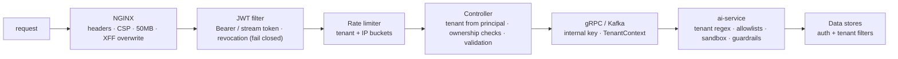

### 5.2 Resilience mechanisms

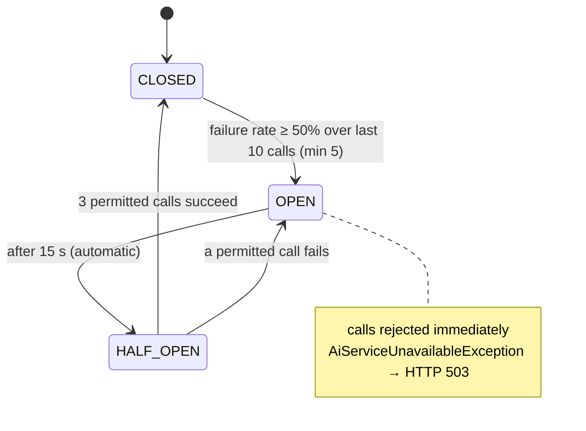

| Mechanism | Configuration | Behaviour |
|---|---|---|
| Circuit breaker `aiServiceGrpc` | count window 10, min 5 calls, 50 % threshold, 15 s open, 3 half-open probes | Protects core-service threads when ai-service is degraded. |
| Retry `aiServiceRetry` | 2 attempts, 500 ms wait, on `AiServiceUnavailableException` | Absorbs transient channel failures (aspect order: retry outside CB). |
| gRPC deadlines | 15 s per call, keep-alive 30 s | Bounded latency; timeouts → 504. |
| After-commit dispatch | `@TransactionalEventListener(AFTER_COMMIT)` + ack wait (15 s) | No Kafka message for rolled-back rows; failed send marks the row `FAILED`. |
| Kafka consumer retries | backoff 1 s ×2, 3 attempts → DLQ | Poison messages never block a partition. |
| Redlock | `SET NX EX` + Lua owner-checked release/renew (TTL/3 heartbeat) | One worker per task/document; lock-store outage fails the work visibly. |
| Rate limiter | Redis Lua, fail-open on Redis errors (logged WARN) | Availability preferred for throttling; auth revocation remains fail-closed. |
| SSE heartbeat | `@Scheduled(fixedRate = 15000)` comment frames, dead emitters pruned | Keeps long streams alive through proxies. |
| Bounded agent loop | `MAX_AGENT_ITERATIONS` (default 2) enforced in `graph.py` | No infinite critic loops. |

### 5.3 AI quality assurance

| Suite | File | Offline (CI default, CPU) | Online (`OPENAI_API_KEY`) |
|---|---|---|---|
| RAGAS | `test_rag_ragas_eval.py` | Context precision/recall, faithfulness, answer relevancy approximated with local BGE embeddings + cross-encoder over a seeded in-memory Qdrant | Native RAGAS LLM-as-judge metrics |
| DeepEval | `test_agent_deepeval.py` | Local hallucination & relevancy metrics over the real LangGraph run | `HallucinationMetric`, `AnswerRelevancyMetric` |
| Giskard | `test_security_giskard.py` | Prompt-injection/jailbreak resistance, cross-tenant leakage probes, perturbation robustness | Full `giskard.scan()` when `RUN_GISKARD_LLM_SCAN=1` |

The golden dataset seeds two tenants (alpha/beta) and asserts that tenant-beta secrets never appear in tenant
alpha's retrieval or reports. CI always runs the offline mode so results are deterministic and free.

### 5.4 CI/CD pipeline

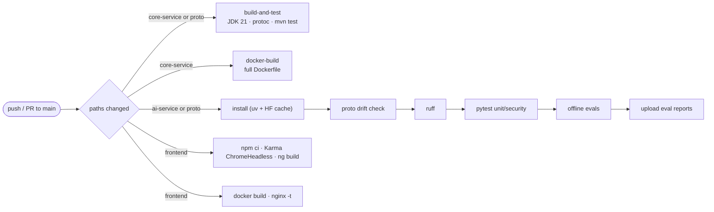

---

## 6. API, gRPC, Kafka, Redis & Database Reference

### 6.1 REST endpoints (via `http://<host>:4200/api/v1`)

All responses use `ApiResponse {success, message, data, timestamp}`.

| Method | Path | Auth | Request | Success response (`data`) |
|---|---|---|---|---|
| POST | `/auth/register` | public, IP-throttled | `{organizationName, organizationSlug, fullName, email, password}` | 201 `AuthResponse` |
| POST | `/auth/login` | public, IP-throttled | `{email, password}` | 200 `{token, userId, tenantId, email, fullName, role, organizationName, expiresInMs}` |
| POST | `/auth/logout` | Bearer | — | 200 (token blacklisted) |
| GET | `/auth/me` | Bearer | — | 200 `UserProfileResponse` |
| POST | `/documents/upload` | Bearer, tenant-throttled | multipart `file`, optional `chunkSize`, `chunkOverlap`, `vectorCollection` | **202** `{documentId, fileName, status: INDEXING, chunksCreated: 0, vectorCollection, createdAt, message}` |
| GET | `/documents` | Bearer | — | 200 `[{id, filename, fileSize, mimeType, vectorCollection, status, chunksCount, errorDetails, createdAt, updatedAt}]` |
| POST | `/documents/search` | Bearer | `{query, topK=5, alpha=0.7, rerank=true, collectionName?, metadataFilters?}` | 200 `{query, totalFound, results:[{chunkId, documentId, content, score, rerankScore, metadata, citation}]}` |
| DELETE | `/documents/{documentId}` | Bearer | — | 200 |
| POST | `/tasks` | Bearer, tenant-throttled | `{prompt, taskType: DEEP_RESEARCH\|DOCUMENT_ANALYSIS, documentIds?, metadata?}` | **202** `TaskResponse` |
| GET | `/tasks` | Bearer | `page=0&size=10&sortBy=createdAt&direction=desc` | 200 `{items, currentPage, totalPages, totalItems, pageSize}` |
| GET | `/tasks/{taskId}` | Bearer | — | 200 `{taskId, tenantId, userId, taskType, status, prompt, resultSummary, lastActiveNode, resultPayload, completedAt, totalTokensUsed, traceId, createdAt, updatedAt}` |
| GET | `/tasks/{taskId}/stream` | Bearer **or** `?token=` | `text/event-stream` | events `HANDSHAKE`, `TASK_PROGRESS`, `TASK_COMPLETED`; `: keep-alive` comments |
| GET | `/agents/mcp-tools` | Bearer | — | 200 `{totalTools, tools:[{name, description, inputSchemaJson, serverOrigin}]}` |

Error codes: 400 validation / bad UUID / disallowed collection / invalid file, 401 missing-invalid-revoked
token, 403 forbidden, 404 not found or not owned, 413 file > 50 MB, 429 rate limited, 500 generic + `traceId`,
503 revocation store or AI circuit unavailable, 504 AI deadline exceeded.

**ai-service internal HTTP** (require `X-Internal-Api-Key`; not exposed through NGINX): `GET /healthz`,
`GET /readyz` (public), `POST /api/v1/rag/search`, `GET /api/v1/mcp/tools`, `POST /api/v1/mcp/call`,
`POST /api/v1/agents/execute`, MCP SSE at `/mcp/sse`.

### 6.2 gRPC (`ai-service:50051`, metadata `x-internal-api-key`)

| Service | RPC | Request → Response | Used by |
|---|---|---|---|
| `RagService` | `IngestDocument` | `IngestDocumentRequest` → `IngestDocumentResponse` | legacy/tooling (uploads use Kafka) |
| `RagService` | `HybridSearch` | `{context, query, top_k, alpha, metadata_filters, rerank, collection_name}` → `{results[DocumentChunk], total_found, query_interpreted}` | `RagGrpcClient` |
| `RagService` | `DeleteDocumentVectors` | `{context, document_id, collection_name}` → `{document_id, success, vectors_deleted, message}` | delete + orphan cleanup |
| `AgentService` | `ListMcpTools` | `{context}` → `{tools[McpToolDefinition], total_tools}` | `AgentController` |
| `AgentService` | `ExecuteAgentSync` | `AgentQueryRequest` → `AgentQueryResponse` | internal |
| `AgentService` | `StreamAgentWorkflow` | `AgentQueryRequest` → stream `AgentWorkflowEvent` | internal |

### 6.3 Kafka topics (3 partitions each, RF 1, retention 7 days)

| Topic | Key | Producer | Consumer (group) | Payload highlights |
|---|---|---|---|---|
| `agent.task.requested` | taskId | core `AgentTaskProducer` (after commit) | ai `KafkaTaskConsumer` (`nexus-ai-agents`) | `taskId, tenantId, prompt, traceId, documentIds, metadata` |
| `agent.task.events` | tenantId | ai `AgentEventPublisher` | core `AgentTaskTelemetryConsumer` (`nexus-core-service-group`) | `nodeType, phase, message, payload, durationMs, timestampMs` |
| `agent.task.completed` | taskId | ai `AgentEventPublisher` | core `AgentTaskTelemetryConsumer` | `status, report, citations, errorDetails?, totalDurationMs` |
| `agent.task.dlq` | task/document id | ai publisher + core `DefaultErrorHandler` | operators | `errorType, error, stackTrace, rawMessage, sourceTopic, partition, offset` |
| `document.ingest.requested` | documentId | core `DocumentIngestProducer` (after commit) | ai `DocumentIngestConsumer` (`nexus-ai-ingest`) | `documentId, tenantId, filePath, fileName, mimeType, chunkSize, chunkOverlap, vectorCollection, metadata, requestedAt` |
| `document.ingest.completed` | documentId | ai `AgentEventPublisher` | core `DocumentIngestCompletedConsumer` (`nexus-core-document-ingest`) | `status INDEXED\|FAILED, chunksCreated, vectorCollection, errorDetails?, durationMs` |

### 6.4 Redis key patterns

| Key | Owner | TTL | Purpose |
|---|---|---|---|
| `tasks_cache::{tenantId}:{taskId}` | core | 30 s | Completed task responses (tenant-scoped). |
| `documents_cache::{tenantId}` | core | 5 min | Tenant document list (never cached while any document is INDEXING). |
| `jwt:blacklist:{sha256(token)}` | core | remaining token lifetime | Logout revocation. |
| `rate_limit:tenant:{tenantId}:{bucket}` | core | window (60 s) | Task submission / upload quota. |
| `rate_limit:ip:{ip}:auth_login` / `auth_register` | core | window (60 s) | Brute-force throttle. |
| `lock:task:{taskId}` | ai | 120 s, renewed | Agent task Redlock. |
| `lock:doc:{documentId}` | ai | 300 s, renewed | Ingestion Redlock. |
| `task:state:{taskId}` | ai | 24 h | Worker-side task state. |
| `agent:checkpoint:{taskId}` (+ `:history`) | ai | 24 h | LangGraph checkpoints. |

Redis runs with `maxmemory 512mb` and `maxmemory-policy noeviction`: writes fail loudly instead of evicting
security-relevant keys.

### 6.5 PostgreSQL schema (`core`)

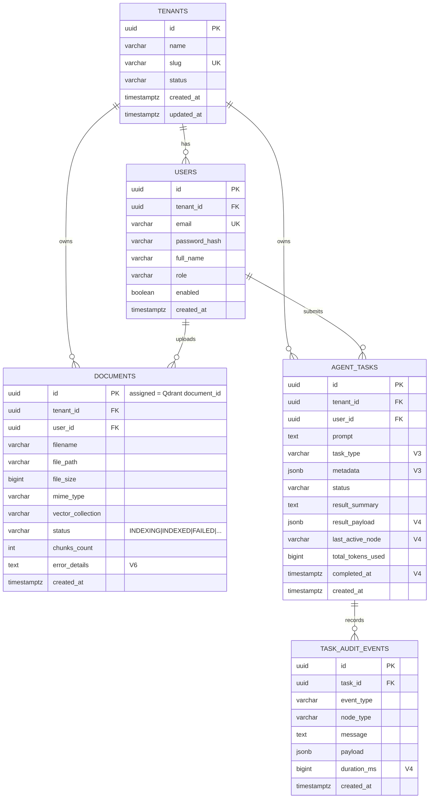

| Migration | Change |
|---|---|
| `V1__init_schema.sql` | Extensions `uuid-ossp`, `pgcrypto`; `tenants`, `users`; indexes on slug, tenant_id, email. |
| `V2__create_tasks_and_events.sql` | `documents`, `agent_tasks`, `task_audit_events`; tenant/status indexes; cascading FKs. |
| `V3__add_task_type_to_agent_tasks.sql` | `agent_tasks.task_type` (default `DEEP_RESEARCH`), `metadata` JSONB, task_type index. |
| `V4__add_telemetry_fields.sql` | `last_active_node`, `result_payload`, `completed_at`; `task_audit_events.duration_ms`; node index. |
| `V5__add_composite_indexes.sql` | `idx_agent_tasks_tenant_created (tenant_id, created_at DESC)`, `idx_documents_tenant_created (tenant_id, created_at DESC)`. |
| `V6__add_document_error_details.sql` | `documents.error_details TEXT`. |

### 6.6 Key configuration

| Variable | Service | Required | Default / notes |
|---|---|---|---|
| `POSTGRES_PASSWORD`, `REDIS_PASSWORD` | compose, core, ai | **yes** | — |
| `JWT_SECRET` | core | **yes** | ≥ 32 characters |
| `INTERNAL_API_KEY` | core, ai | **yes** | ≥ 16 characters |
| `QDRANT_API_KEY` | qdrant, ai | **yes** | — |
| `LLM_API_KEY` / `LLM_BASE_URL` / `LLM_MODEL` | ai | no | empty → deterministic / OpenAI / `gpt-4o-mini` |
| `MAX_AGENT_ITERATIONS` | ai | no | 2 |
| `MANAGEMENT_PORT` | core | no | 8081 |
| `RATE_LIMIT_RPM` / `RATE_LIMIT_AUTH_RPM` | core | no | 30 / 10 |
| `RAG_ALLOWED_COLLECTIONS` / `ALLOWED_COLLECTIONS` | core / ai | no | `enterprise_docs` |
| `KAFKA_TASK_SEND_TIMEOUT_MS` | core | no | 15000 |
| `AI_SERVICE_GRPC_DEADLINE_MS` | core | no | 15000 |

---

## 7. Verification Evidence & Known Limitations

### 7.1 Test inventory (last run, `main` @ `6cf259b`)

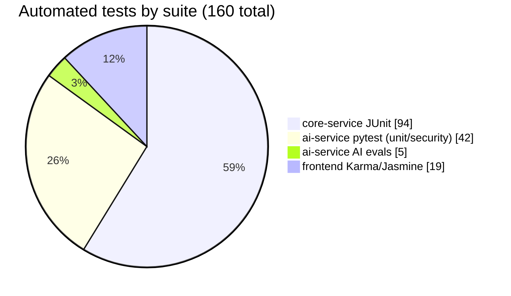

### 7.2 Live end-to-end verification (46/46 checks passed)

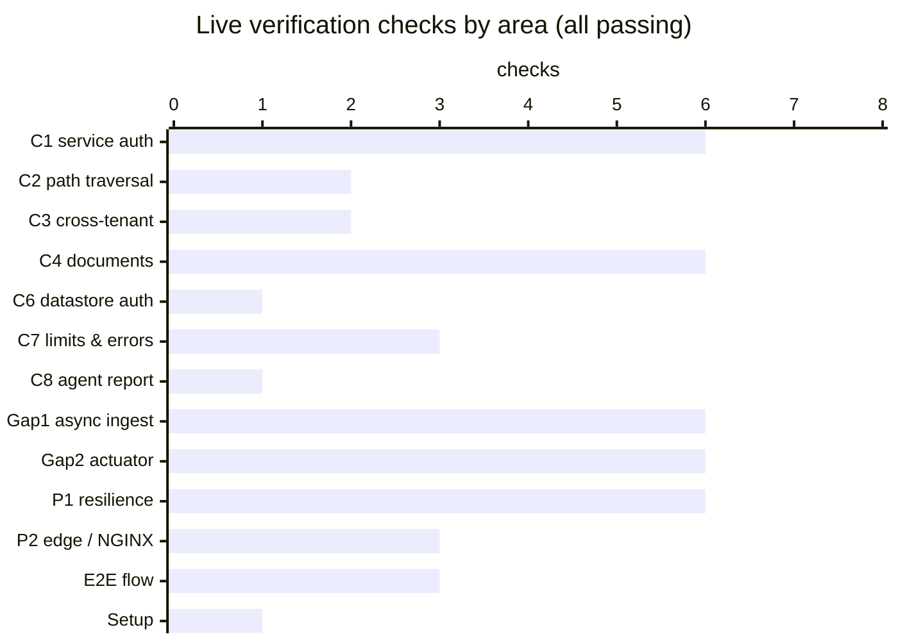

### 7.3 Measured ingestion timings (CPU-only container)

| Measurement | Value |
|---|---|
| 2 MB text upload → HTTP 202 | **123 ms** |
| Small document → `INDEXED` | ~3 s (consumer processing ≈ 0.1 s) |
| 2 MB document (4,629 chunks) → `INDEXED` | 246 s (≈ 19 chunks/s embedding on CPU) |
| Agent task end-to-end (deterministic mode) | ≈ 4.2 s `totalDurationMs` |

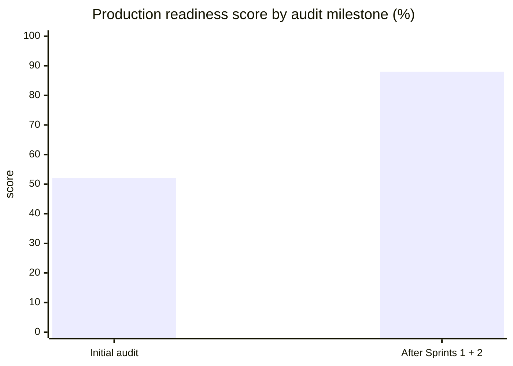

### 7.4 Known limitations (accepted / backlog)

| Area | Limitation | Mitigation / next step |
|---|---|---|
| SSE scale-out | `TaskStreamHub` is in-memory; multiple core-service replicas need event fan-out. | Redis Pub/Sub broadcast between replicas. |
| Upload latency | Upload waits for the Kafka ack (≤ 15 s, typically ~70 ms). | Transactional outbox + relay. |
| DOCX parsing | Validator accepts `.docx`, but `parser.py` has no DOCX extractor (raw-text fallback). | Add `python-docx` extraction. |
| Embedding throughput | CPU embedding ≈ 19 chunks/s. | GPU node or larger batch workers; scale `nexus-ai-ingest` consumers (3 partitions). |
| Frontend container | NGINX master runs as root. | `nginx-unprivileged` on port 8080 + compose mapping. |
| Token storage | JWT in `localStorage` (mitigated by strict CSP). | HttpOnly cookie or short-lived stream tickets. |
| Rate limiter | Fails open when Redis is unreachable (documented choice). | Local fallback bucket. |
| TLS | Gateway serves HTTP. | Terminate TLS at NGINX or an upstream load balancer and add HSTS. |
