# NexusEnterprise Hub — User Guide

Welcome! This guide walks you through NexusEnterprise Hub from your very first sign-in to running a
multi-agent research task over your own documents. Every screenshot below was captured from the live
application running locally at `http://localhost:4200`.

> Looking for internals (ports, Kafka topics, security design)? See the
> [Technical Architecture Guide](TECHNICAL_ARCHITECTURE_GUIDE.md).

**Your first 10 minutes at a glance**

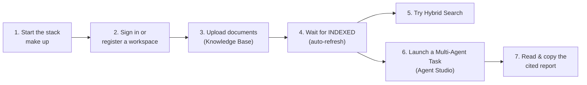

---

## 1. Getting Started

### 1.1 Prerequisites

- Docker Desktop (or Docker Engine + Compose v2) with **at least 6 GB of RAM** assigned
- `make` (or run the equivalent `docker compose` command shown below)
- A modern browser (Chrome, Edge, Firefox, Safari)

### 1.2 Start NexusEnterprise Hub

1. Copy the environment template and replace every `change-me` value with your own strong secrets:

   ```bash
   cp .env.example .env
   ```

   Required: `POSTGRES_PASSWORD`, `REDIS_PASSWORD`, `QDRANT_API_KEY`, `JWT_SECRET` (at least 32 characters)
   and `INTERNAL_API_KEY` (at least 16 characters). The stack refuses to start while any of them is missing.

2. Start everything with one command:

   ```bash
   make up
   ```

   (Equivalent: `docker compose --env-file .env -f deploy/docker-compose.yml -f deploy/docker-compose.override.yml up -d --build`.)

3. Wait until all containers report `healthy` (`make status`), then open **http://localhost:4200**.
   The first start takes a few minutes while images build and the AI models load.

### 1.3 Sign in

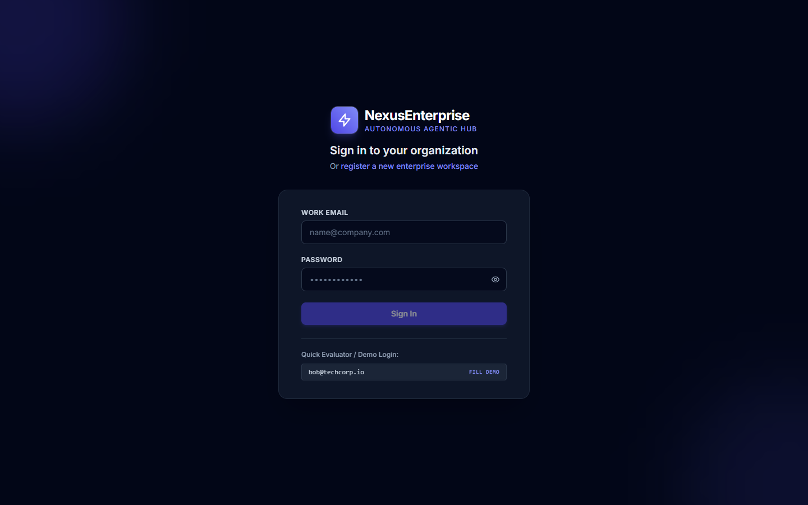

- Enter your **work email** and **password**, then click **Sign In**.
- On a demo installation you can click **Fill Demo** under *Quick Evaluator / Demo Login* to pre-fill the
  demo account (`bob@techcorp.io`). Ask your administrator for the demo password.
- Your session lasts **24 hours**. Signing out immediately invalidates your session token.

### 1.4 Create a brand-new organization workspace

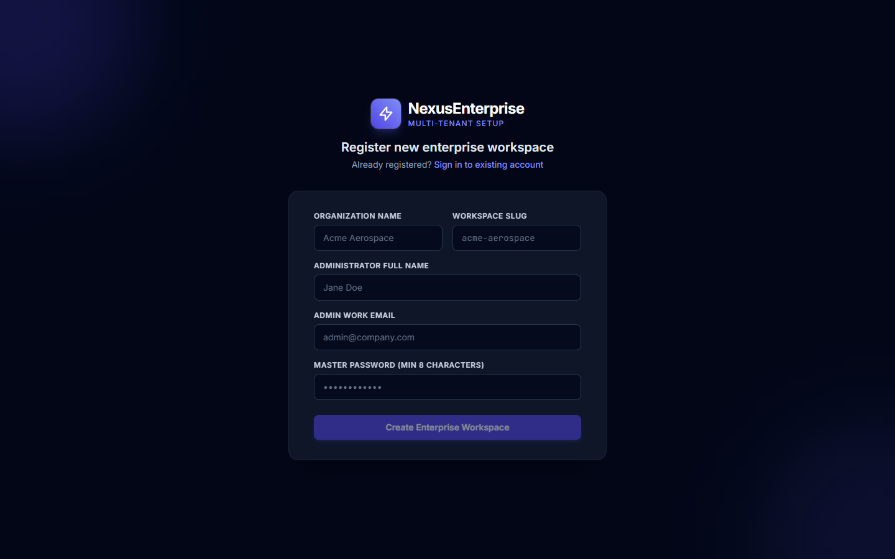

Click **register a new enterprise workspace** on the login page and fill in:

| Field | Example | Notes |
|---|---|---|
| Organization Name | Acme Aerospace | Shown in the tenant badge. |
| Workspace Slug | `acme-aerospace` | Unique, lowercase identifier of your workspace. |
| Administrator Full Name | Jane Doe | You become the workspace **ADMIN**. |
| Admin Work Email | admin@company.com | Used to sign in. |
| Master Password | min. 8 characters | Choose a strong, unique password. |

Each workspace is a fully isolated **tenant**: documents, search results, agent tasks and reports of one
organization are never visible to another.

---

## 2. Navigating the Command Center

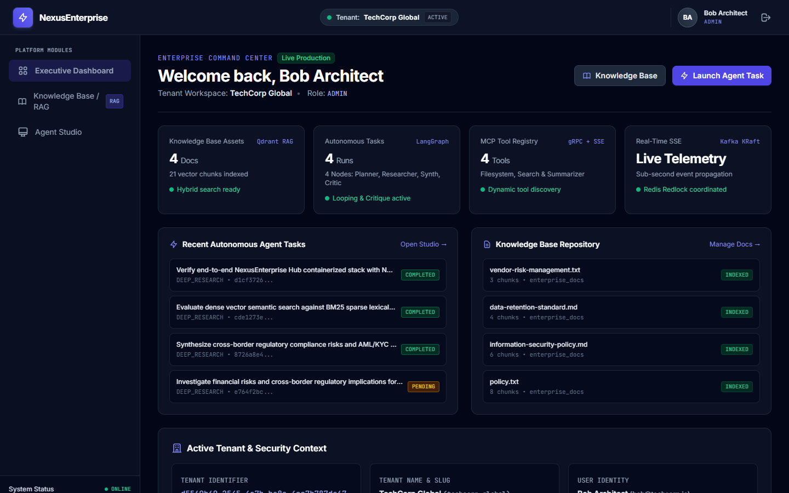

| Area | What it shows |
|---|---|
| **Sidebar (left)** | *Executive Dashboard*, *Knowledge Base / RAG* and *Agent Studio*. |
| **Tenant badge (top center)** | The workspace you are working in (e.g. *TechCorp Global — ACTIVE*). |
| **User menu (top right)** | Your name and role (e.g. `ADMIN`) and the sign-out button. |
| **System Status (bottom left)** | Live indicator refreshed every 30 seconds: **Online** (gateway and API up), **Degraded** (gateway up, API unavailable), **Offline** (gateway unreachable). |
| **KPI cards** | Number of documents and indexed chunks, agent task runs, available MCP tools and live telemetry status. |
| **Recent Autonomous Agent Tasks** | Your latest agent runs with status `PENDING`, `PROCESSING`, `COMPLETED` or `FAILED`. *Open Studio →* jumps to Agent Studio. |
| **Knowledge Base Repository** | Your latest documents and their indexing status. *Manage Docs →* opens the Knowledge Base. |
| **Active Tenant & Security Context** | Your tenant identifier, workspace slug and user identity. |

Use **Knowledge Base** and **Launch Agent Task** (top right) as shortcuts.

---

## 3. Building Your Knowledge Base

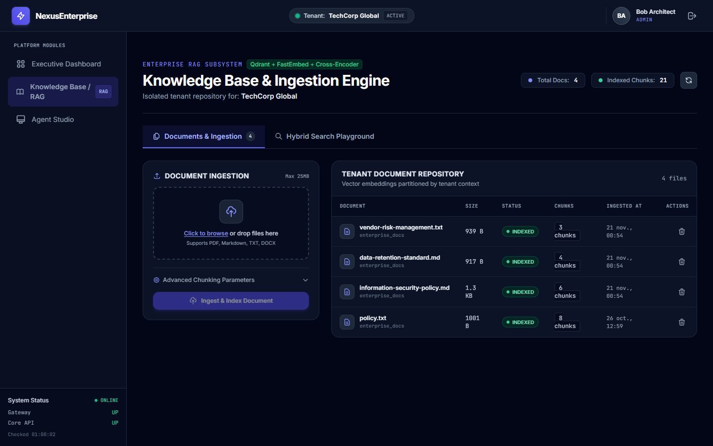

### 3.1 Supported files

| Format | Extension | Notes |
|---|---|---|
| PDF | `.pdf` | Text is extracted page by page; citations include page numbers. |
| Plain text | `.txt` | UTF-8 text. |
| Markdown | `.md` | Headings and tables are kept in the chunk text. |
| Word | `.docx` | Accepted, but text extraction for Word files is currently basic. For best results, export to PDF first. |

**Size limit:** the upload panel accepts files up to **25 MB** (the server itself allows up to 50 MB through
the API). Files are checked by **extension and content**: a renamed executable or a "PDF" that is not really
a PDF is rejected.

### 3.2 Upload a document

1. Open **Knowledge Base / RAG** → **Documents & Ingestion**.
2. Click **Click to browse** or drag & drop a file onto the upload zone.
3. *(Optional)* Expand **Advanced Chunking Parameters**:
   - **Chunk Size** (100–2000 characters, default **500**): how much text goes into each searchable passage.
     Smaller chunks give more precise matches; larger chunks keep more context together.
   - **Chunk Overlap** (0–300 characters, default **50**): how much text consecutive chunks share, so that
     sentences on a boundary are not cut in half.
4. Click **Ingest & Index Document**.

### 3.3 Watch indexing happen

Uploads are processed **in the background**, so the page never freezes, even for large files.

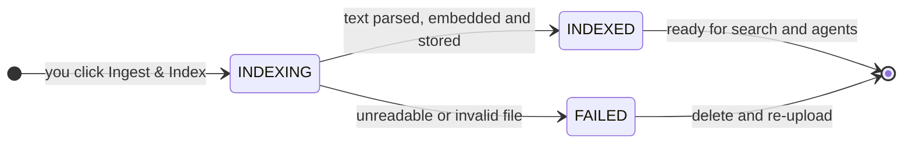

- The document appears immediately with the status **INDEXING**.
- The table **refreshes automatically every 3 seconds** while anything is indexing, and you get a
  notification when it finishes.
- Small documents are ready within seconds; a 2 MB text file takes a few minutes on a CPU-only server.
- **INDEXED** documents show their number of chunks. **FAILED** documents show why and can be re-uploaded.

### 3.4 Delete a document safely

Click the **trash icon** in the *Actions* column and confirm. The file, its record and **all** of its search
vectors are removed together, so deleted content never shows up in search results or agent reports again.
This cannot be undone.

---

## 4. Running Hybrid Search & Reranking

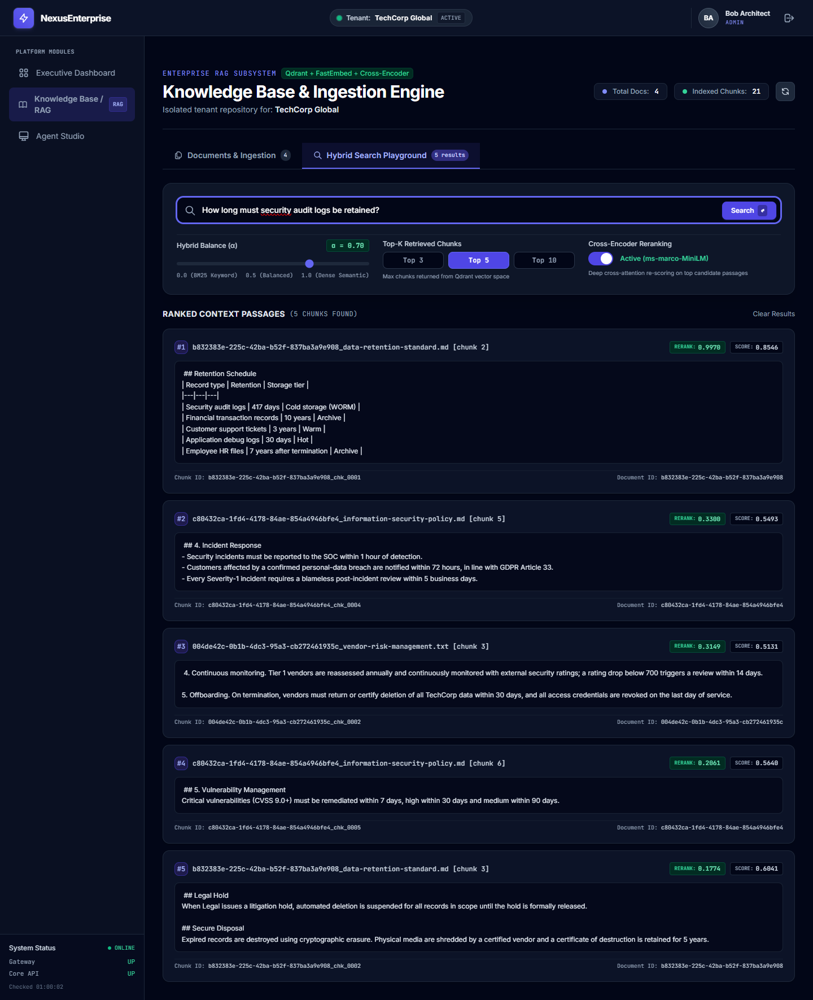

Open **Knowledge Base / RAG** → **Hybrid Search Playground**, type a question and click **Search**.

### 4.1 Search controls

| Control | Options | What it does |
|---|---|---|
| **Hybrid Balance (α)** | 0.0 → 1.0 (default **0.70**) | Mixes keyword and meaning-based search (see below). |
| **Top-K Retrieved Chunks** | Top 3 · **Top 5** · Top 10 | How many passages to return. |
| **Cross-Encoder Reranking** | On (default) / Off | Re-scores the best candidates with a precise AI relevance model. |

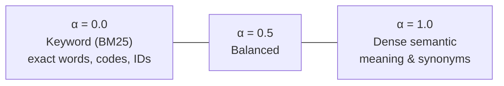

**Tips**

- Searching for exact identifiers such as `VRM-07` or `ISP-2026`? Move α towards **0.0**.
- Asking a natural-language question ("how long do we keep logs?")? Keep α around **0.7** or higher.
- Leave **Reranking on** for the best ordering; turn it off only to compare raw retrieval quality.

### 4.2 Reading the results

Each result card shows:

- **Rank** (`#1`, `#2`, …) and the **citation**: source file and chunk number (plus page number for PDFs).
- **RERANK** — the cross-encoder relevance score (higher is better; the main ranking signal when reranking is on).
- **SCORE** — the hybrid retrieval score `α × semantic + (1 − α) × keyword`.
- The passage text, the **Chunk ID** and the **Document ID** it came from.

In the example above, the question *"How long must security audit logs be retained?"* returns the retention
schedule as result #1 with a rerank score of **0.997**, showing the **417 days** cold-storage rule.

---

## 5. Using the Multi-Agent Studio

### 5.1 Compose a task

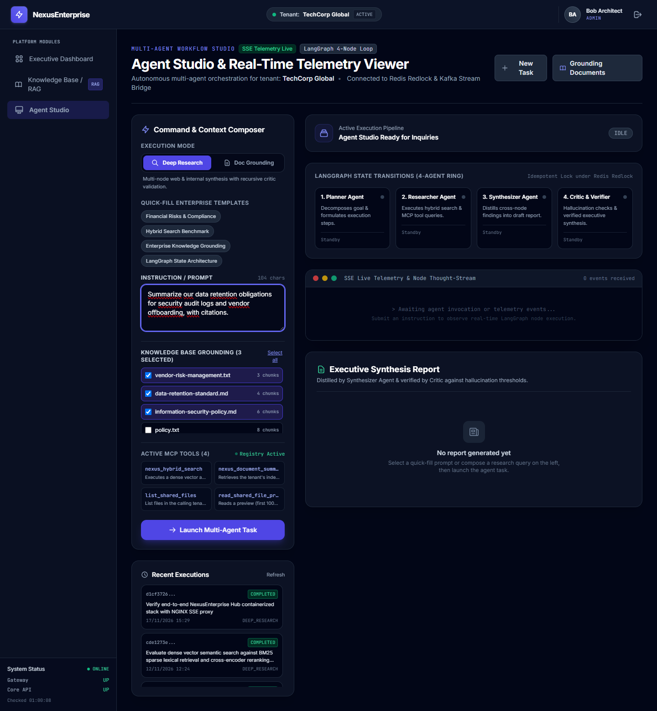

1. **Execution Mode**
   - **Deep Research** (`DEEP_RESEARCH`): broad, multi-query research across your knowledge base.
   - **Doc Grounding** (`DOCUMENT_ANALYSIS`): focused analysis of the documents you select.
2. **Quick-Fill Enterprise Templates**: one click inserts a ready-made prompt you can edit.
3. **Instruction / Prompt**: describe what you want to know, ideally asking for citations.
4. **Knowledge Base Grounding**: tick the documents the agents should focus on (*Select all* is available).
5. **Active MCP Tools**: the tools the agents may use, such as hybrid search, the document summarizer and
   your workspace's file listing. Tools only ever see your own workspace's data.
6. Click **Launch Multi-Agent Task**.

### 5.2 Watch the agents work in real time

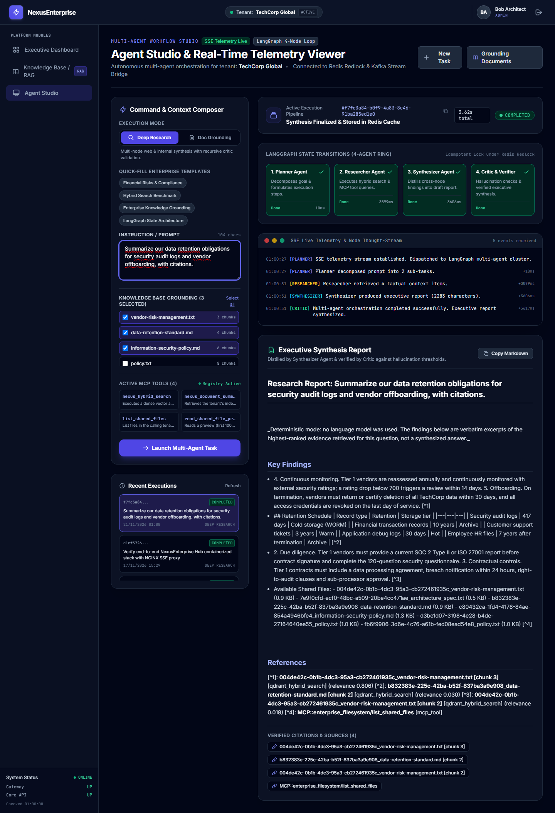

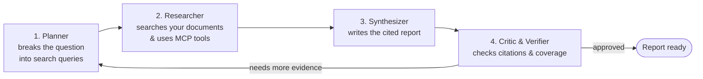

- **Active Execution Pipeline** shows the task ID, total time and status (`COMPLETED` above, in 3.6 s).
- **LangGraph State Transitions** light up as each of the four agents finishes, with their timings.
- **SSE Live Telemetry & Node Thought-Stream** is a live log of every step, streamed to your browser as it
  happens. Long-running tasks keep the connection alive automatically.
- The Critic can send the work back to the Planner for another round. The number of rounds is capped, so a
  task always finishes.

### 5.3 Read, copy and revisit reports

- **Executive Synthesis Report** contains the answer, **Key Findings**, numbered footnotes (`[^1]`) and a
  **References** section listing the exact sources and relevance scores.
- **Verified Citations & Sources** lists each cited passage.
- Click **Copy Markdown** to paste the report into a document, ticket or wiki.
- **Recent Executions** keeps your past runs; click one to reopen its report.

> **Deterministic mode.** When no language model is configured (the default), the report says
> *"Deterministic mode: no language model was used"* and lists the most relevant verbatim excerpts instead of a
> written answer. Nothing is invented. Enable a real LLM (next section) for fully written answers.

---

## 6. Enabling a Real LLM (Optional)

NexusEnterprise Hub works with any **OpenAI-compatible** API.

1. Open `.env` and set the three variables for your provider:

   | Provider | `LLM_API_KEY` | `LLM_BASE_URL` | `LLM_MODEL` (example) |
   |---|---|---|---|
   | OpenAI | your OpenAI key | *(leave empty)* | `gpt-4o-mini` |
   | Groq | your Groq key | `https://api.groq.com/openai/v1` | `llama-3.1-70b-versatile` |
   | Ollama (local) | any non-empty value, e.g. `ollama` | `http://host.docker.internal:11434/v1` | `llama3.1` |

   Model names are examples; use any chat model your provider currently offers.

2. Restart only the AI service:

   ```bash
   docker compose --env-file .env -f deploy/docker-compose.yml -f deploy/docker-compose.override.yml up -d ai-service
   ```

3. Launch a new task in Agent Studio. The report is now written by the model, with `[^n]` citations that
   point to your documents, and the Critic additionally fact-checks the draft.

If the provider is unreachable, agents automatically fall back to deterministic mode and the report lists
the problem under *Retrieval Issues*.

---

## 7. Troubleshooting FAQ

| Symptom | Why it happens | What to do |
|---|---|---|
| **"Too many requests" (429)** | Each workspace can launch about 30 agent tasks or uploads per minute, and each network address about 10 sign-in or registration attempts per minute. | Wait for the time shown in the message (usually under a minute) and retry. |
| **"File Too Large"** / **413** | The upload panel accepts up to 25 MB; the server rejects anything over 50 MB. | Split the document or compress embedded images. |
| **"Invalid file type"** (400) | The file is not a PDF, TXT, Markdown or DOCX, or its content does not match its extension. | Export the document as PDF or plain text and upload it again. |
| Document stuck on **INDEXING** for a long time | Large files take minutes on CPU-only servers. | Keep the page open; it refreshes automatically. If it ends in **FAILED**, check the reason shown and re-upload. |
| Document shows **FAILED** | The file could not be read or contained no extractable text (e.g. a scanned image PDF). | Use a text-based PDF or TXT/MD file. |
| Search returns nothing | No **INDEXED** documents in your workspace yet, or the query terms don't appear in them. | Wait for indexing to finish, or move α towards 0.5 to mix in keyword matching. |
| Signed out unexpectedly | Your session lasts 24 hours, or you signed out on another tab. | Sign in again. Other errors (rate limits, server issues) show a notification and never sign you out. |
| Status indicator shows **Degraded** | The gateway is up but the backend API is restarting or unavailable. | Wait a minute; ask your administrator to check `make status` if it persists. |
| Agent report says *Deterministic mode* | No LLM is configured. | Follow [Enabling a Real LLM](#6-enabling-a-real-llm-optional). |
